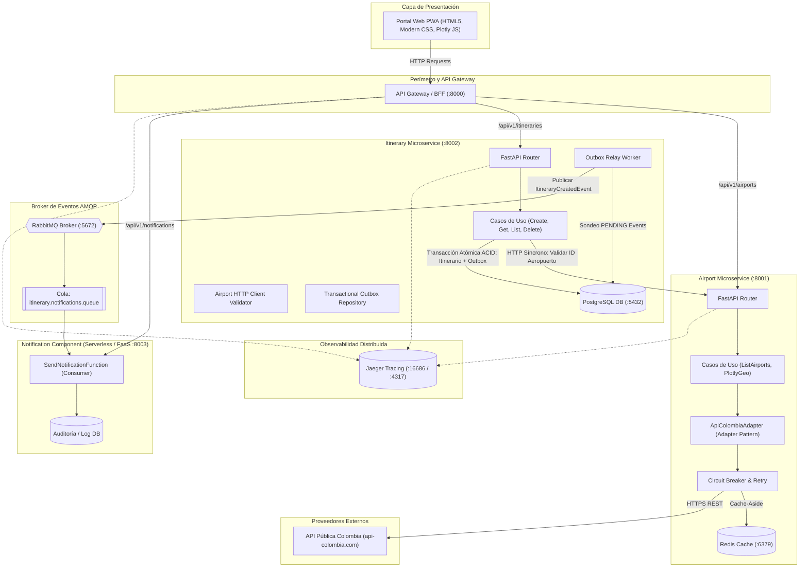

# Especificación Arquitectónica del Sistema Distribuido de Itinerarios
**Sistema:** Plataforma Distribuida de Gestión y Visualización de Itinerarios de Viaje  
**Fecha de Actualización:** 04 de Noviembre de 2026  
**Documento Maestro:** Arquitectura Integral, Rúbrica de Evaluación y Modelo de Servicios

---

## 1. Rúbrica Oficial de Evaluación del Proyecto

A continuación se transcribe la rúbrica formal que rige la entrega del proyecto:

1. **Documento de arquitectura (corto)** en base a los ejemplos que están en el aula virtual.
2. **Arquitectura basada en microservicios (HTTP, Eventos)**: la arquitectura interna por cada microservicio debe ser estrictamente **Hexagonal (Puertos y Adaptadores)**.
3. **Patrón Adapter**: debe estar implementado formalmente para desacoplar fuentes externas o formatos específicos del núcleo de negocio.
4. **Ciclo DevOps Completo**:
   - **a. Planning (Backlog) -> Jira**: Épicas, historias de usuario estructuradas con criterios de aceptación (Gherkin) y estimación de puntos de historia (Story Points).
   - **b. Repositorios en Git**:
     - *i. Pull Requests*: Evidencia de revisiones de código controladas.
     - *ii. Ramas estándares*: Estrategia de ramificación formal (GitFlow: `main`, `develop`, `feature/*`, `fix/*`).
   - **c. Pruebas**:
     - *i. Unitarias*: Pruebas automatizadas con Pytest cubriendo adaptadores, casos de uso y lógica de dominio.
     - *ii. Carga*: Pruebas de estrés y concurrencia implementadas con **Locust** y **k6**.
   - **d. Swagger (OpenAPI)**: Documentación viva e interactiva expuesta en `/docs` por cada microservicio y por el API Gateway.
   - **e. SonarQube**: Configuración formal (`sonar-project.properties`), Quality Gates y exportación de reportes de cobertura (`coverage.xml`).
   - **f. Despliegue Continuo (CI/CD)**: Pipeline automatizado en GitHub Actions (`.github/workflows/ci-cd.yml`) ejecutando linters (Ruff/Black), suite de pruebas, análisis de calidad estática, construcción multi-stage de imágenes Docker y verificación de despliegue.
   - **g. Dockerizado**:
     - Docker Compose orquestador para levantar el sistema completo (8 contenedores interconectados).
     - Docker Compose individual por cada microservicio para desarrollo aislado.
   - **h. Diseño Básico de Software**: Principios SOLID, Domain-Driven Design (DDD), Clean Architecture, tipado estricto con Pydantic v2 y aislamiento de persistencia.

---

## 2. Visión Global de la Arquitectura del Sistema

El sistema implementa de forma sinérgica tres paradigmas arquitectónicos modernos:
1. **Microservicios Autónomos:** Separación por responsabilidades y almacenamiento aislado por servicio.
2. **Arquitectura Basada en Eventos (Event-Driven Architecture - EDA):** Comunicación asíncrona garantizada mediante el patrón **Transactional Outbox**, evitando el *Double Write Problem* hacia el broker RabbitMQ.
3. **Procesamiento Reactivo Serverless (FaaS):** Notificaciones y analítica ejecutadas bajo demanda como funciones efímeras.

---

## 3. Especificación Detallada por Componente y Proyecto

### 3.1 `airport-service` (Puerto 8001)
* **Propósito:** Catálogo maestro y canónico de terminales aéreos en Colombia.
* **Paradigma:** Arquitectura Hexagonal pura.
* **Estructura Interna:**
  * `domain/models/airport.py`: Entidad de dominio inmutable `Airport` con ID, código IATA, nombre, ciudad, departamento, tipo, latitud y longitud.
  * `domain/ports/external_airport_port.py`: Interfaz abstracta para consultar aeropuertos externos.
  * `domain/ports/cache_port.py`: Interfaz abstracta para operaciones de almacenamiento en caché.
  * `application/list_airports.py`: Orquestador que aplica la estrategia **Cache-Aside**.
  * `application/get_airports_for_plotly.py`: Transforma entidades de dominio al formato Scattergeo requerido por la librería de mapas.
  * `infrastructure/adapters/api_colombia_adapter.py`: Implementación formal del **Patrón Adapter**. Traduce estructuras JSON heterogéneas y anidadas provenientes de `api-colombia.com` hacia la entidad canónica `Airport`.
  * `infrastructure/adapters/circuit_breaker.py`: Máquina de estados formal (`CLOSED`, `OPEN`, `HALF_OPEN`) con umbral de 3 fallos consecutivos, tiempo de recuperación de 30 segundos y catálogo canónico seguro de fallback (*Fail-Fast*).
  * `infrastructure/adapters/redis_cache_adapter.py`: Adaptador Redis con TTL de 3600 segundos y fallback transparente en memoria.
* **Endpoints:**
  * `GET /api/v1/airports`: Retorna catálogo canónico completo.
  * `GET /api/v1/airports/{airport_id}`: Retorna detalle de un aeropuerto (usado para validación síncrona).
  * `GET /api/v1/airports/map/plotly`: Retorna payload optimizado de trazas y layout para `Plotly.newPlot()`.
  * `GET /health`: Estado de conectividad con Redis y métricas del Circuit Breaker.

### 3.2 `itinerary-service` (Puerto 8002)
* **Propósito:** Gestión transaccional del ciclo de vida de los itinerarios de viaje (CRUD).
* **Paradigma:** Arquitectura Hexagonal + DDD + EDA (Event-Driven Architecture).
* **Decisiones de Diseño (DDD):**
  * **Agregado Itinerario:** Contiene `id`, `user_name`, `origin_airport_id`, `destination_airport_id`, `departure_date`, `duration_minutes` y `status`.
  * **Referencia de Valor Externa (Value Reference):** El servicio **NO** duplica el catálogo de aeropuertos en su base de datos. Solo almacena los identificadores enteros como referencias foráneas lógicas validadas síncronamente contra `airport-service`.
* **Resolución del Double Write Problem (Transactional Outbox):**
  * `CreateItineraryUseCase` abre una transacción relacional ACID en PostgreSQL.
  * Inserta el itinerario en la tabla `itineraries` e inmediatamente inserta el evento `ItineraryCreatedEvent` en la tabla `outbox_events` con estado `PENDING`.
  * Ambas operaciones se confirman (`COMMIT`) juntas. Si falla la base de datos, no se emite ningún mensaje fantasma; si tiene éxito, el evento queda registrado de forma indeleble.
  * En segundo plano, `OutboxRelayWorker` sondea los eventos `PENDING`, los despacha hacia el topic exchange `itinerary.events` de RabbitMQ esperando la confirmación (`Publisher Confirms`), y actualiza el registro a `PUBLISHED`.
* **Endpoints:**
  * `POST /api/v1/itineraries`: Valida aeropuertos vía HTTP, inserta itinerario y evento outbox (`201 Created`).
  * `GET /api/v1/itineraries`: Lista los itinerarios persistidos.
  * `GET /api/v1/itineraries/{id}`: Detalle de itinerario por UUID.
  * `DELETE /api/v1/itineraries/{id}`: Eliminación de itinerario (`204 No Content`).
  * `GET /health`: Estado de PostgreSQL y del worker outbox.

### 3.3 `notification-service` (Puerto 8003 - Serverless / FaaS)
* **Propósito:** Componente reactivo orientado a funciones efímeras.
* **Paradigma:** Serverless Function-as-a-Service (FaaS) activada por eventos.
* **Componentes:**
  * `SendNotificationFunction`: Consumer AMQP que escucha la cola `itinerary.notifications.queue` conectada al topic exchange `itinerary.events` con routing key `itinerary.created`.
  * Al llegar el mensaje, deserializa el payload, simula el despacho por canal (EMAIL / SMS / PUSH) y registra la transacción en la tabla de auditoría `notifications_log`.
* **Endpoints:**
  * `GET /api/v1/notifications/report`: Consolidación de métricas de alertas despachadas y eventos procesados.
  * `GET /health`: Estado del consumidor AMQP.

### 3.4 `api-gateway` (Puerto 8000)
* **Propósito:** Punto perimetral único de entrada del sistema (BFF / Reverse Proxy).
* **Responsabilidades:**
  * Enrutamiento inteligente hacia microservicios backend:
    * `/api/v1/airports/*` $\rightarrow$ `airport-service:8001`
    * `/api/v1/itineraries/*` $\rightarrow$ `itinerary-service:8002`
    * `/api/v1/notifications/*` $\rightarrow$ `notification-service:8003`
  * Servicio de archivos estáticos del frontend (`/app/frontend`).
  * Control de tráfico: Algoritmo de *Rate Limiting* (Sliding Window de 60 peticiones/minuto por IP).
  * Observabilidad perimetral: Inyección y propagación de cabeceras W3C Trace Context (`traceparent`).
  * Preservación y reenvío de tokens JWT de autenticación.

### 3.5 `frontend` (Capa de Cliente Web)
* **Estado Actual:**
  * Implementado como un SPA monolítico simple (`index.html`, `app.js`, `style.css`) servido por el Gateway.
  * Integración con Plotly JS para Scattergeo.
* **Deficiencias Detectadas y Oportunidades de Mejora:**
  1. *Filtro de Aeropuertos ausente:* Posee un `<select>` nativo no ergonómico con más de 50 opciones, difícil de navegar.
  2. *Mapa en blanco:* La inicialización cartográfica presenta fallas de renderizado de marcadores y proyecciones.
  3. *Ausencia de trazado de rutas:* El mapa solo intenta mostrar aeropuertos aislados, sin enlazar gráficamente los orígenes y destinos de los itinerarios creados.
  4. *Navegación plana (Mono-vista):* Todo está amontonado en una sola pantalla estática.
  5. *Emojis y falta de seriedad visual:* Elementos como `✈️` en encabezados le restan seriedad corporativa.
  6. *Falta de capacidades PWA:* No cuenta con Service Worker ni `manifest.json` para instalación en escritorio y móviles.

---

## 4. Middleware y Persistencia

| Servicio | Tecnología | Puerto | Rol |
| :--- | :--- | :--- | :--- |
| **PostgreSQL** | `postgres:15-alpine` | `5432` | Base de datos relacional para `itineraries` y `outbox_events`. |
| **Redis** | `redis:7-alpine` | `6379` | Caché en memoria de catálogo canónico de aeropuertos. |
| **RabbitMQ** | `rabbitmq:3.12-management-alpine` | `5672`, `15672` | Broker AMQP para intercambio de eventos desacoplados. |
| **Jaeger** | `jaegertracing/all-in-one:1.55` | `16686`, `4317` | Trazabilidad distribuida y análisis de latencia con OpenTelemetry. |

---

## 5. Contratos de Comunicación y Estándares

1. **REST / OpenAPI 3.0:** Todos los microservicios generan automáticamente esquemas OpenAPI tipados mediante Pydantic v2.
2. **AsyncAPI 2.6.0:** Contrato asíncrono formal documentado en [`docs/asyncapi.yaml`](file:///c:/Dev/Universidad/Arquitectura%20Soft/Taller-Git-Prueba/docs/asyncapi.yaml):
   * **Exchange:** `itinerary.events` (Tipo: Topic).
   * **Routing Key:** `itinerary.created`.
   * **Payload:** UUID de evento, identificador de agregado, pasajero, códigos IATA y marcas de tiempo UTC.
3. **Observabilidad W3C:** Propagación de cabecera `traceparent` (`00-{trace_id}-{span_id}-01`) en todas las interacciones síncronas y asíncronas.
