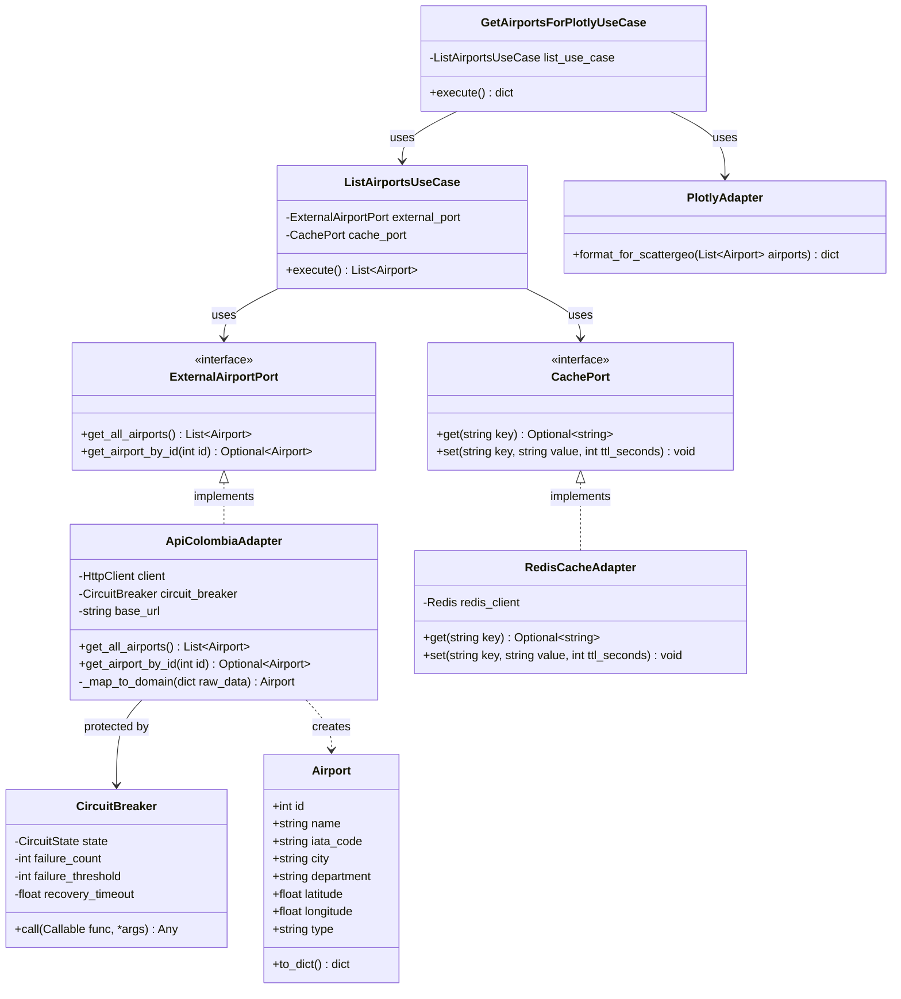
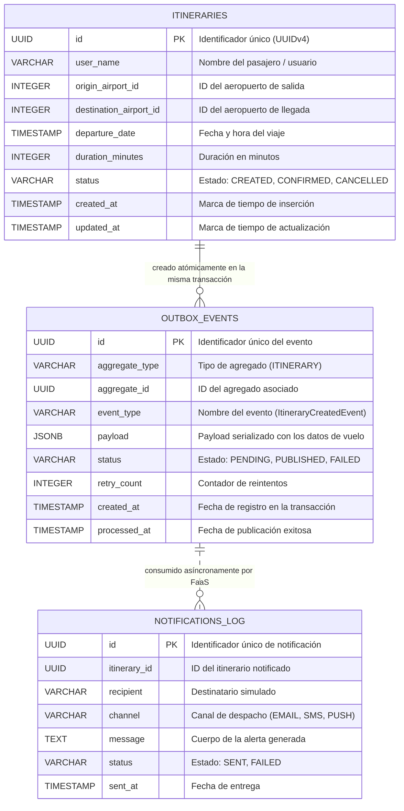
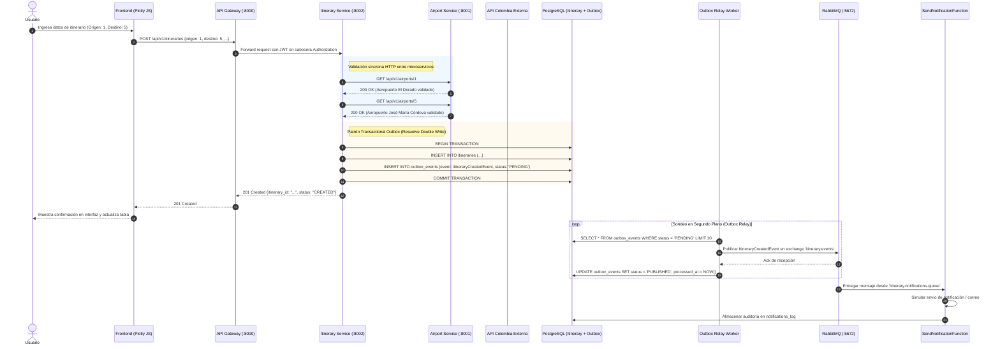
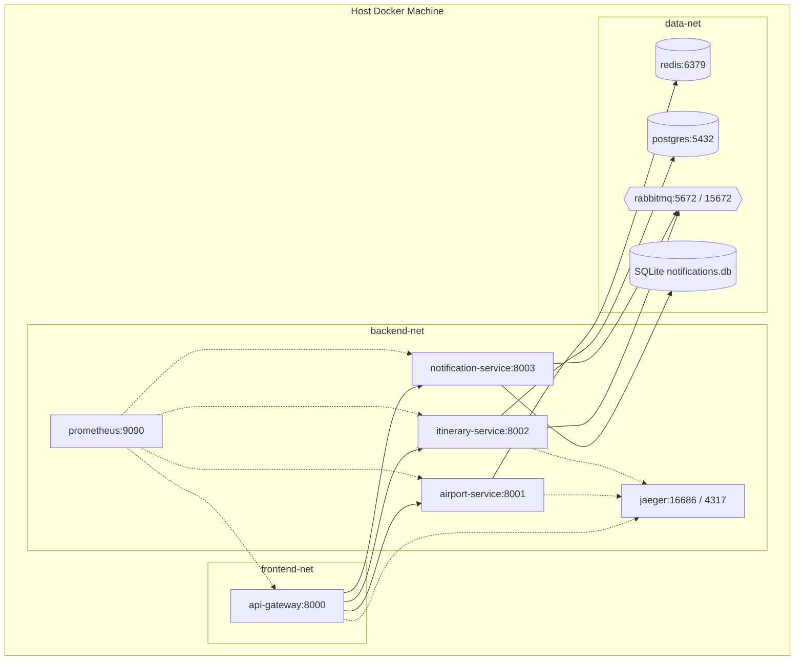

# Sistema Distribuido de Itinerarios Personales
> **Plataforma Distribuida de Microservicios, Arquitectura Hexagonal, Resiliencia, Transactional Outbox y Serverless FaaS**  
> **Proyecto:** Taller de Arquitectura de Software  
> **Autores:** Nicolás (nicoo-code) — Equipo de Desarrollo y Arquitectura  
> **Fecha:** Noviembre 2026  

---

## 1. Descripción General del Proyecto

El **Sistema Distribuido de Itinerarios Personales** es una solución de ingeniería de software empresarial que integra de manera sinérgica tres paradigmas arquitectónicos fundamentales:
1. **Arquitectura de Microservicios:** Servicios independientes (`airport-service`, `itinerary-service`, `notification-service` y `api-gateway`), cada uno con su propio almacenamiento persistente y comunicación desacoplada a través de HTTP síncrono y eventos AMQP.
2. **Arquitectura Basada en Eventos (Event-Driven Architecture):** Publicación asíncrona garantizada mediante el patrón **Transactional Outbox**, evitando el *Double Write Problem* y asegurando consistencia eventual entre la base de datos relacional y el broker **RabbitMQ**.
3. **Arquitectura Sin Servidor (Serverless / FaaS):** Procesamiento reactivo y bajo demanda de notificaciones y analítica (`SendNotificationFunction` y `GenerateReportFunction`) activadas exclusivamente por eventos sin mantener servidores sobredimensionados.

### Tecnologías Principales:
- **Backend & Core:** Python 3.11+, FastAPI, Pydantic v2, SQLAlchemy 2.0, Alembic.
- **Resiliencia & Caché:** Circuit Breaker (Closed, Open, Half-Open), Retry con Exponential Backoff y Jitter aleatorio, Redis 7 Alpine.
- **Mensajería & Broker:** RabbitMQ 3.12 (AMQP 0-9-1) con Publisher Confirms y contratos **AsyncAPI 2.6.0**.
- **Base de Datos:** PostgreSQL 15 (Itinerarios y Outbox) y SQLite en almacenamiento embebido para auditoría.
- **Frontend:** HTML5, CSS3 moderno responsivo y **Plotly JS v2.27.0** para visualización geoespacial interactiva (Scattergeo).
- **Observabilidad & DevOps:** OpenTelemetry (OTLP gRPC), Jaeger (Tracing distribuido con W3C `traceparent`), Prometheus + Alerting (`/metrics` y `alerts.yml`), Logs estructurados JSON, Kubernetes (`k8s/`), GitHub Actions CI/CD y SonarQube.
- **Seguridad:** Autenticación y propagación de JWT (`HS256` con `PyJWT`) desde `api-gateway` (`POST /api/v1/auth/token`) hacia `itinerary-service`.

---

## 2. Diagramas de Arquitectura (Sintaxis Mermaid)

### 2.1 Diagrama de Componentes del Sistema

```mermaid
graph TB
    subgraph Cliente["Capa de Presentación"]
        Browser["Navegador Web / Frontend (Plotly JS + HTML5)"]
    end

    subgraph Perimetro["API Gateway / Perímetro"]
        Gateway["API Gateway / Reverse Proxy (Port 8000)"]
    end

    subgraph AirportMS["Airport Microservice (Port 8001)"]
        AirportController["FastAPI Router"]
        AirportUseCase["Airport Use Cases"]
        AdapterAPI["ApiColombiaAdapter (Adapter Pattern)"]
        CB["Circuit Breaker & Retry"]
        RedisCache[("Redis Cache (Port 6379)")]
    end

    subgraph ItineraryMS["Itinerary Microservice (Port 8002)"]
        ItineraryController["FastAPI Router"]
        ItineraryUseCase["Itinerary Use Cases"]
        AirportValidator["Airport HTTP Client Validator"]
        OutboxRepo["Transactional Outbox Repository"]
        ItineraryDB[("PostgreSQL Itinerary DB (Port 5432)")]
        OutboxRelay["Outbox Relay Worker"]
    end

    subgraph Broker["Capa Asíncrona / Mensajería"]
        RabbitMQ{{"RabbitMQ Broker (Exchange: itinerary.events)"}}
        ItineraryQueue[["Queue: itinerary.notifications.queue"]]
    end

    subgraph Serverless["Notification Component (Serverless / FaaS)"]
        NotificationFunc["SendNotificationFunction (Consumer)"]
        NotificationDB[("Notification Log DB")]
    end

    subgraph Observabilidad["Capa de Observabilidad"]
        Jaeger[("Jaeger Tracing (Port 16686 / 4317)")]
        Prometheus[("Prometheus Metrics")]
    end

    subgraph External["Servicios Externos"]
        ApiColombia["API Colombia Externa (https://api-colombia.com/api/v1/Airport)"]
    end

    Browser -->|HTTP Requests| Gateway
    Gateway -->|/api/v1/airports| AirportController
    Gateway -->|/api/v1/itineraries| ItineraryController

    AirportController --> AirportUseCase
    AirportUseCase --> AdapterAPI
    AdapterAPI --> CB
    CB -->|Cache Check / Store| RedisCache
    CB -->|HTTPS REST| ApiColombia

    ItineraryController --> ItineraryUseCase
    ItineraryUseCase -->|HTTP Sync Validation| AirportController
    ItineraryUseCase -->|Atomic TX: Itinerary + Outbox| ItineraryDB
    OutboxRelay -->|Poll Pending Events| ItineraryDB
    OutboxRelay -->|Publish ItineraryCreatedEvent| RabbitMQ

    RabbitMQ --> ItineraryQueue
    ItineraryQueue --> NotificationFunc
    NotificationFunc --> NotificationDB

    AirportController -.-> Jaeger
    ItineraryController -.-> Jaeger
    AirportController -.-> Prometheus
    ItineraryController -.-> Prometheus
```



---

### 2.2 Diagrama de Clases: Arquitectura Hexagonal y Patrón Adapter



---

### 2.3 Diagrama Entidad-Relación (Persistencia Relacional)



---

### 2.4 Diagrama de Secuencia Integral (E2E)



---

### 2.5 Diagrama de Despliegue (Docker Orchestration)



---

## 3. Decisiones de Diseño y Domain-Driven Design (DDD)

### 3.1 Contextos Delimitados (Bounded Contexts)
1. **Airport Catalog Context (Upstream - Published Language):**  
   Gestiona la verdad canónica de los terminales aéreos en Colombia, sus códigos IATA y coordenadas. Expone un contrato estable para el resto del ecosistema mediante el patrón Adapter.
2. **Itinerary Management Context (Downstream - Customer/Supplier):**  
   Gestiona la reserva, planificación, actualización y persistencia transaccional de itinerarios creados por pasajeros.
3. **Notification & Analytics Context (Downstream - Subscriber / FaaS):**  
   Procesa asíncronamente los eventos de dominio para enviar alertas reactivas y consolidar reportes bajo demanda.

### 3.1.1 Lenguaje Ubicuo (Ubiquitous Language)
| Término | Contexto | Significado en el Dominio |
| :--- | :--- | :--- |
| **Airport (Aeropuerto)** | Airport Catalog | Entidad canónica que representa una terminal aérea colombiana (`id`, `name`, `iata_code`, `city`, `department`, `latitude`, `longitude`, `type`). |
| **Itinerary (Itinerario)** | Itinerary Management | Agregado raíz que registra un viaje de un pasajero entre un aeropuerto origen y destino en una fecha y duración determinadas (`CREATED`, `CONFIRMED`, `CANCELLED`). |
| **External Airport Reference** | Itinerary Management | Referencia por ID (`origin_airport_id`, `destination_airport_id`) validada síncronamente sin duplicar datos maestros. |
| **Outbox Event** | Itinerary Management | Registro persistido en `outbox_events` dentro de la misma transacción ACID del itinerario para garantizar entrega confiable al broker. |
| **Integration Event** | Mensajería (AMQP) | Contrato versionado (`ItineraryCreatedEvent` en `docs/asyncapi.yaml`) publicado en RabbitMQ para consumo desacoplado. |
| **Notification Audit** | Notification & Analytics | Registro inmutable en `notifications_log` que audita cada alerta procesada por `SendNotificationFunction`. |
| **Circuit Breaker** | Resiliencia | Máquina de estados (`CLOSED`, `OPEN`, `HALF-OPEN`) que protege al `airport-service` frente a fallos de la API externa. |

### 3.2 Decisión sobre el Agregado Aeropuerto (Referencia de Valor Externa)
> En el microservicio de itinerarios, **el Aeropuerto NO se modela como un Agregado completo ni se duplican sus datos maestros**. Se modela estrictamente como una **Referencia de Identidad Externa (Value Reference / External ID)**.  
> **Justificación Arquitectónica:** Si duplicáramos los aeropuertos en la base de datos de itinerarios, cualquier cambio en nombres, pistas o municipios generaría anomalías de sincronización. Al mantener solo el identificador validado síncronamente vía HTTP, respetamos el principio de responsabilidad única y evitamos acoplamiento de esquemas.

### 3.3 Eventos de Dominio vs. Eventos de Integración
- **Evento de Dominio:** Ocurre dentro del agregado del microservicio (ej. validación interna de fechas de viaje).
- **Evento de Integración:** Notificación formal (`ItineraryCreatedEvent`) emitida fuera de las fronteras del microservicio mediante el broker AMQP. Utiliza contratos versionados (`docs/asyncapi.yaml`) para que sistemas externos (como la función Serverless) consuman los cambios sin acoplamiento a la base de datos interna.

### 3.4 Patrón Adapter Formal
- **API Colombia:** La API externa (`https://api-colombia.com/api/v1/Airport`) posee una estructura heterogénea (ciudades como objetos anidados, campos nulos, etc.). El adaptador `ApiColombiaAdapter` implementa `ExternalAirportPort` y traduce estas variaciones al modelo canónico `Airport`.
- **Plotly JS:** El adaptador `PlotlyAdapter` transforma la lista de aeropuertos a las series paralelas `lat`, `lon`, `text` e `ids` requeridas por la función `Plotly.newPlot()`.

### 3.5 Resolución del Double Write Problem (Transactional Outbox)
- **Problema:** En arquitecturas de microservicios, guardar en la base de datos y publicar en el broker de mensajería en dos pasos separados produce inconsistencias cuando uno de los dos falla.
- **Solución:** `CreateItineraryUseCase` abre una transacción relacional en PostgreSQL donde inserta en `itineraries` y en `outbox_events` (`status = 'PENDING'`) de forma **atómica**. Si la base de datos falla, nada se publica; si la transacción es exitosa, el worker `OutboxRelayWorker` sondea los registros y garantiza el envío a RabbitMQ mediante **Publisher Confirms** actualizando el estado a `PUBLISHED`.

### 3.6 Flujo Asíncrono de Notificaciones (Event-Driven + FaaS)
1. Cuando el usuario crea un itinerario (`POST /api/v1/itineraries`), `itinerary-service` valida el token JWT, verifica los aeropuertos contra `airport-service` y persiste atómicamente el itinerario y el evento `ItineraryCreatedEvent` en `outbox_events` (incluyendo `trace_id`).
2. El worker `OutboxRelayWorker` lee los eventos `PENDING` y los publica en el topic exchange `itinerary.events` de **RabbitMQ** siguiendo el contrato de `docs/asyncapi.yaml`.
3. La cola durable `itinerary.notifications.queue` entrega el evento a `notification-service`, que ejecuta reactivamente la función `SendNotificationFunction` (simulando el envío de alerta y guardando la auditoría en su propia base de datos SQLite `notifications_log`, propagando el `trace_id` en logs JSON).
4. Adicionalmente, `GenerateReportFunction` consolida métricas bajo demanda a través de `GET /api/v1/notifications/report`. *(Nota: en entorno local Docker Compose el paradigma FaaS se ejecuta como un servicio reactivo orientado a eventos con funciones desacopladas).*

---

## 4. Instrucciones de Ejecución y Validación del Despliegue

### 4.1 Prerrequisitos
- Docker Desktop corriendo en Windows/Linux/macOS con soporte para Docker Compose v2+.
- Python 3.11+ (opcional para ejecutar pruebas localmente fuera de contenedores).
- Git configurado.

### 4.2 Clonado del Repositorio
Todos los microservicios, infraestructura, manifiestos Kubernetes y documentación se encuentran integrados en el repositorio principal:
```bash
git clone https://github.com/nicoo-code/Taller-Git-Prueba.git
cd Taller-Git-Prueba
```

### 4.3 Despliegue Local con Comando Único
Para compilar y desplegar toda la arquitectura de microservicios, bases de datos, observabilidad y middleware:
```bash
docker compose up --build -d
```
*(Alternativa en Windows PowerShell: `.\scripts\init_environment.ps1`)*

Al arrancar `itinerary-service`, su `entrypoint.sh` ejecuta automáticamente `alembic upgrade head` antes de iniciar `uvicorn`.

### 4.4 Validación del Despliegue Local (Paso a Paso)
1. **Verificar el estado de los Contenedores:**
   ```bash
   docker compose ps
   ```
   *Criterio de éxito:* Los **9 contenedores** deben mostrar estado `Up` o `healthy`:
   - `api-gateway` (Puerto 8000)
   - `airport-service` (Puerto 8001)
   - `itinerary-service` (Puerto 8002)
   - `notification-service` (Puerto 8003)
   - `postgres-itinerary` (Puerto 5432)
   - `redis` (Puerto 6379)
   - `rabbitmq` (Puertos 5672 y 15672)
   - `jaeger` (Puertos 16686, 4317 y 4318)
   - `prometheus` (Puerto 9090)

2. **Validar URLs de Acceso y Servicios Disponibles:**
   | Servicio | URL | Método de Validación |
   | :--- | :--- | :--- |
   | **Frontend Web App** | [http://localhost:8000](http://localhost:8000) | Cargar mapa Plotly JS y registrar/eliminar un itinerario (el frontend gestiona el JWT automáticamente). |
   | **API Gateway Health / Auth** | [http://localhost:8000/health](http://localhost:8000/health) | `GET /health` y `POST /api/v1/auth/token` para emitir un JWT Bearer. |
   | **Airport Swagger UI** | [http://localhost:8001/docs](http://localhost:8001/docs) | Probar `GET /api/v1/airports?limit=10&offset=0` (`X-Total-Count`) y `DELETE /api/v1/airports/cache`. |
   | **Itinerary Swagger UI** | [http://localhost:8002/docs](http://localhost:8002/docs) | Probar CRUD completo (`POST`, `GET`, `PUT`, `DELETE`) con cabecera `Authorization: Bearer <token>`. |
   | **Notification FaaS** | [http://localhost:8003/api/v1/notifications/report](http://localhost:8003/api/v1/notifications/report) | Consultar métricas y logs de notificaciones procesadas (`/api/v1/notifications/logs`). |
   | **RabbitMQ Management** | [http://localhost:15672](http://localhost:15672) | Login `guest`/`guest` → Verificar exchange `itinerary.events` y cola `itinerary.notifications.queue`. |
   | **Jaeger Tracing UI** | [http://localhost:16686](http://localhost:16686) | Buscar trazas distribuidas (`api-gateway` → `itinerary-service` → `airport-service`) con `traceparent`. |
   | **Prometheus & Alerting** | [http://localhost:9090/alerts](http://localhost:9090/alerts) | Verificar targets `/metrics` activos y reglas `AirportCircuitBreakerOpen`, `HighHttp5xxErrorRate`, `MicroserviceDown`. |

3. **Verificar Logs Estructurados en Tiempo Real:**
   ```bash
   docker compose logs -f api-gateway itinerary-service airport-service
   ```

### 4.5 Despliegue en Kubernetes (Nivel 3)
Los manifiestos listos para despliegue con `Deployments`, `Services`, `ConfigMap`, `Secret`, límites de recursos y sondas `readinessProbe` / `livenessProbe` están en `k8s/`:
```bash
kubectl apply -f k8s/
kubectl get pods,svc -n itinerarios-app
```

### 4.6 Validación del Despliegue Continuo en GitHub Actions (CI/CD)
Cada vez que se sube una rama (`main`, `develop`, `feature/**` o `feat/**`), GitHub Actions ejecuta automáticamente el pipeline:
1. Ir a la pestaña **Actions** en el repositorio de GitHub: [https://github.com/nicoo-code/Taller-Git-Prueba/actions](https://github.com/nicoo-code/Taller-Git-Prueba/actions).
2. Seleccionar la última ejecución del workflow **"CI/CD Pipeline - Sistema Distribuido de Itinerarios"**.
3. Comprobar que los 5 jobs pasen con check verde (`✔`):
   - **Linting and Code Formatting:** `ruff` y `black`.
   - **Unit Tests & Coverage Report:** `pytest` con reporte `coverage.xml`.
   - **SonarQube Static Analysis:** Quality Gate y métricas de código.
   - **Docker Multi-Stage Build Verification:** Construcción de las 4 imágenes Docker.
   - **Continuous Deployment Verification:** Validación sintáctica y orquestación con `docker compose config`.

---

## 5. Guía de Pruebas y Evidencias de Funcionamiento

### 5.1 Pruebas Unitarias, de Integración y E2E
Ejecutar la suite completa de pruebas:
```powershell
# En Windows PowerShell:
.\scripts\run_tests.ps1

# O directamente con pytest:
python -m pytest tests/unit tests/e2e -v
python -m pytest services/airport-service/tests -v
python -m pytest services/itinerary-service/tests -v
```
*Resultado actual:* **43 passed, 1 skipped** en la suite raíz (`tests/unit` + `tests/e2e`), **23 passed** en `airport-service` y **13 passed** en `itinerary-service`, con `ruff check .` y `black --check .` al 100% en verde.

### 5.2 Pruebas E2E Reales con Testcontainers (PostgreSQL + Redis + RabbitMQ)
Para ejecutar la suite E2E contra contenedores Docker efímeros reales (requiere Docker activo):
```bash
pip install -r tests/requirements-e2e.txt
pytest tests/e2e/test_e2e_testcontainers.py -m e2e_containers -v
```

### 5.3 Demostración de Falla Controlada (Circuit Breaker)
Para evidenciar cómo el sistema tolera caídas de la API externa y responde en menos de 5ms mediante fallback fail-fast:
```bash
python tests/chaos/test_resilience_circuit_breaker.py
```
*Evidencia Obtenida:*
- Estado inicial: `CLOSED`.
- Tras 3 fallos consecutivos, el circuito conmuta a `OPEN`.
- Peticiones en estado `OPEN` responden en **< 5ms** con datos seguros en memoria/caché.
- Pasada la ventana de recuperación, transiciona a `HALF-OPEN` para verificar restablecimiento.

### 5.4 Pruebas de Carga con k6 y Locust
```bash
# Prueba de carga k6 para catálogo de aeropuertos:
k6 run tests/load/k6_airports_load.js

# Prueba de carga k6 para creación de itinerarios y outbox:
k6 run tests/load/k6_itineraries_load.js

# Prueba de carga distribuida con Locust:
locust -f tests/load/locustfile.py --host=http://localhost:8000
```

---

## 6. Tabla de Autoevaluación Detallada (Rúbrica Académica)

A continuación se detalla y justifica honestamente el cumplimiento de cada criterio exigido en `Requerimientos taller.md` para los tres niveles:

| Nivel | Criterio de Evaluación | Estado | Justificación Técnica de Cumplimiento |
| :---: | :--- | :---: | :--- |
| **Nivel 1** | **Patrón Adapter** | ✅ CUMPLIDO | Implementado formalmente mediante el puerto `ExternalAirportPort` y el adaptador `ApiColombiaAdapter` que mapea el JSON externo al modelo `Airport`. Adaptador `PlotlyAdapter` para ScatterGeo. |
| **Nivel 1** | **Arquitectura Hexagonal** | ✅ CUMPLIDO | Separación estricta en 3 capas por microservicio: Dominio (`domain`), Aplicación (`application`) e Infraestructura (`infrastructure`). Reglas de dependencia DIP respetadas. |
| **Nivel 1** | **DDD Básico** | ✅ CUMPLIDO | Definición explícita de Contextos Delimitados (Airport, Itinerary, Notification) y Lenguaje Ubicuo documentados en `docs/architecture/SAD.md` y `README.md`. |
| **Nivel 1** | **CRUD de Itinerarios** | ✅ CUMPLIDO | CRUD completo (`POST`, `GET`, `PUT`, `DELETE`) en `itinerary-service` con validación HTTP síncrona de aeropuertos contra `airport-service` (`CreateItineraryUseCase`, `UpdateItineraryUseCase`, `Get/List/Delete`). |
| **Nivel 1** | **Base de Datos Relacional** | ✅ CUMPLIDO | PostgreSQL 15 integrado con SQLAlchemy 2.0 en `itinerary-service` (`itineraries` y `outbox_events`) y SQLite aislado en `notification-service` (`notifications_log`). |
| **Nivel 1** | **Migraciones de BD** | ✅ CUMPLIDO | Migraciones versionadas con **Alembic** (`alembic.ini`, `env.py`, `versions/001_initial_schema.py`) ejecutadas automáticamente al arrancar mediante `entrypoint.sh` (`alembic upgrade head`). |
| **Nivel 1** | **Swagger / OpenAPI** | ✅ CUMPLIDO | Documentación automática e interactiva activa en `/docs` de cada microservicio. |
| **Nivel 1** | **Manejo de Errores** | ✅ CUMPLIDO | Códigos HTTP consistentes: 200, 201, 204, 400, 401, 404, 422, 429, 503. |
| **Nivel 1** | **Logs Estructurados** | ✅ CUMPLIDO | Formateador `JsonFormatter` en todos los servicios emitiendo JSON en stdout con `timestamp`, `level`, `service`, `trace_id` y `span_id`. |
| **Nivel 1** | **Frontend con Plotly JS** | ✅ CUMPLIDO | Interfaz web responsiva con Plotly JS v2.27.0 renderizando mapa geográfico de Colombia, combobox predictivo de aeropuertos, gestión de itinerarios y autenticación JWT transparente. |
| **Nivel 1** | **Docker + docker-compose** | ✅ CUMPLIDO | Dockerfiles multi-stage por servicio y `docker-compose.yml` maestro que orquesta los 9 contenedores con redes aisladas y healthchecks. |
| **Nivel 1** | **README y Diagramas** | ✅ CUMPLIDO | Documentación exhaustiva con 5 diagramas Mermaid (Componentes, Clases, ER, Secuencia y Despliegue), DDD, Lenguaje Ubicuo y ADRs. |
| **Nivel 2** | **Circuit Breaker** | ✅ CUMPLIDO | Máquina de estados formal (`CLOSED`, `OPEN`, `HALF-OPEN`) con umbral de 3 fallos, timeout de 30s y fail-fast con fallback en `circuit_breaker.py`. |
| **Nivel 2** | **Retry con Backoff** | ✅ CUMPLIDO | 3 intentos con backoff exponencial (base 0.5s) y jitter aleatorio (0-100ms) implementado en `ApiColombiaAdapter`. |
| **Nivel 2** | **Caché Redis** | ✅ CUMPLIDO | `RedisCacheAdapter` conectado a Redis 7 con TTL, fallback en memoria e invalidación explícita (`DELETE /api/v1/airports/cache` vía `CachePort.delete`). |
| **Nivel 2** | **API Gateway** | ✅ CUMPLIDO | Gateway perimetral con proxy inverso (`httpx`), rate limiting (60 req/min), emisión de tokens (`POST /api/v1/auth/token`) y propagación de JWT y `traceparent`. |
| **Nivel 2** | **Notification Service** | ✅ CUMPLIDO | Tercer microservicio reactivo orientado a eventos consumiendo RabbitMQ (`SendNotificationFunction`, `GenerateReportFunction`) con persistencia propia SQLite. |
| **Nivel 2** | **Broker de Mensajería** | ✅ CUMPLIDO | RabbitMQ 3.12 con topic exchange `itinerary.events` y cola durable `itinerary.notifications.queue`. |
| **Nivel 2** | **AsyncAPI** | ✅ CUMPLIDO | Especificación formal YAML en `docs/asyncapi.yaml` (AsyncAPI 2.6.0) detallando contratos de mensajes y esquemas JSON. |
| **Nivel 2** | **Trazas Distribuidas** | ✅ CUMPLIDO | OpenTelemetry real (`TracerProvider`, `OTLPSpanExporter` hacia Jaeger `4317`, `FastAPIInstrumentor`, `HTTPXClientInstrumentor`) y propagación W3C `traceparent` entre gateway, servicios y logs. |
| **Nivel 2** | **Propagación de JWT** | ✅ CUMPLIDO | Emisión y validación HS256 (`PyJWT`) en `api-gateway`, propagación de `Authorization: Bearer <token>` y validación S2S (`require_jwt_token`) en mutaciones (`POST`, `PUT`, `DELETE`) de `itinerary-service`. |
| **Nivel 2** | **Pruebas E2E** | ✅ CUMPLIDO | Suite E2E rápida (`tests/e2e/test_full_flow.py`) + suite E2E real con **Testcontainers** (`tests/e2e/test_e2e_testcontainers.py` levantando PostgreSQL, Redis y RabbitMQ efímeros). |
| **Nivel 2** | **Demostración de Resiliencia** | ✅ CUMPLIDO | Script automatizado `tests/chaos/test_resilience_circuit_breaker.py` evidenciando apertura del circuito y respuesta fallback en < 5ms. |
| **Nivel 3** | **Transactional Outbox** | ✅ CUMPLIDO | Tabla `outbox_events` escrita en la misma transacción atómica ACID que el itinerario, y worker `OutboxRelayWorker` despachando a RabbitMQ con Publisher Confirms. |
| **Nivel 3** | **Consistencia Distribuida** | ✅ CUMPLIDO | Resolución y justificación arquitectónica del **Double Write Problem** documentada en SAD, ADR-003 y README. |
| **Nivel 3** | **Alerting (Prometheus)** | ✅ CUMPLIDO | Endpoints `/metrics` en los 4 servicios, contenedor `prometheus` en `docker-compose.yml` y reglas de alerta en `infra/prometheus/alerts.yml` (`AirportCircuitBreakerOpen`, `HighHttp5xxErrorRate`, `MicroserviceDown`). |
| **Nivel 3** | **CI/CD Pipeline** | ✅ CUMPLIDO | Pipeline multi-job en GitHub Actions (`.github/workflows/ci-cd.yml`) con linting (`ruff`/`black`), tests con cobertura (`pytest`), SonarQube y Docker build/config. |
| **Nivel 3** | **Kubernetes** | ✅ CUMPLIDO | Manifiestos completos en `k8s/` (`00-namespace-config.yaml` a `05-api-gateway.yaml`) con Deployments, Services, recursos y probes `readinessProbe` / `livenessProbe`. |
| **Nivel 3** | **API Versioning & Paginación** | ✅ CUMPLIDO | Endpoints versionados `/api/v1/...` con paginación retrocompatible (`limit`, `offset`) y cabecera `X-Total-Count` en `airports` e `itineraries`. |
| **Nivel 3** | **Pruebas de Carga y Calidad** | ✅ CUMPLIDO | Scripts de carga `k6` (`k6_airports_load.js`, `k6_itineraries_load.js`), `locustfile.py` y configuración SonarQube (`sonar-project.properties`). |
| **Nivel 3** | **gRPC / S2S mTLS / Vault / Chaos Mesh / Bulkhead / Pact** | ⬜ NO IMPLEMENTADO | Criterios bonus opcionales fuera del alcance actual del entregable (la comunicación interna se mantiene en HTTP REST + JWT S2S y el caos se demuestra vía `test_resilience_circuit_breaker.py`). |

---
*Fin del README maestro del proyecto.*
